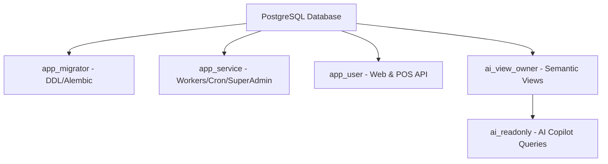

# ERP / POS Tizimi: Asosiy Ilovani RLS va `app_service` Roliga O'tkazish Rejasi

> **Hujjat maqsadi:** AI Copilot doirasida joriy etilgan Row-Level Security (RLS) va `ai_readonly` izolyatsiyasini kelgusida butun ERP/POS ilovasiga (veb-interfeys, POS, background workerlar, Telegram botlar, internet-do'kon va rejalashtiruvchi) kengaytirishning bosqichma-bosqich rejasi.

---

## 1. Joriy Holat (Current State)

| Qatlam | Rol | Imtiyoz | RLS ta'siri |
|---|---|---|---|
| **AI Copilot (Read)** | `ai_readonly` | SELECT faqat `ai_v_*` view'lariga, `default_transaction_read_only=on`, `statement_timeout='10s'` | **Qat'iy RLS (Fail-closed)**: `NULLIF(current_setting('app.company_id', true), '')::integer = company_id` |
| **AI View Egasi** | `ai_view_owner` | NOLOGIN, `ai_v_*` semantik view'larining egasi | RLS siyosatlari orqali asosiy jadvallarga xavfsiz ulanadi |
| **AI Yozish (Tasdiqlash)** | Server-side (`pending_actions`) | HIGH xavfli amallar faqat `/ai/confirm` orqali tranzaksiyada bajariladi | RBAC, TTL va audit nazorati |
| **Asosiy Ilova (Web/POS)** | `postgres` (Superuser) | ALL PRIVILEGES | PostgreSQL superuser bo'lgani sababli RLS ni avtomatik chetlab o'tadi (`rolbypassrls=true`) |

---

## 2. Kelajakdagi Maqsadli Arxitektura (Target Role Hierarchy)

Kelgusida ilovaning ma'lumotlar bazasiga ulanishi superuser (`postgres`) dan quyidagi ajratilgan rollarga o'tkaziladi:



### Rollar va Ularning Vazifalari:

1. **`app_migrator`** (Alembic va DDL uchun):
   - Faqat migratsiyalarni yurgizish (`alembic upgrade head`) uchun ishlatiladi.
   - Jadvallar, indekslar, rollar va siyosatlarni yaratish huquqiga ega.

2. **`app_user`** (Asosiy API — Web va POS uchun):
   - `NOLOGIN` yoki maxsus parolga ega standart foydalanuvchi.
   - `rolsuper = false`, `rolbypassrls = false`.
   - Har bir HTTP so'rov kirganda `get_current_user` dan `company_id` olinadi va sessiyada o'rnatiladi:
     ```sql
     SELECT set_config('app.company_id', :current_company_id, true);
     ```
   - Har qanday SQL so'rovi (hatto xom `db.query(...)` bo'lsa ham) avtomatik ravishda faqat joriy korxona ma'lumotlarini qaytaradi.

3. **`app_service`** (Tizimiy va ko'p korxonali servislar uchun):
   - `rolsuper = false`, ammo `BYPASSRLS` imtiyozi beriladi yoki o'zgaruvchi orqali global kirish huquqiga ega.
   - Fon vazifalari (Celery/APScheduler), hisobot agregatorlari, SMS yuboruvchi workerlar va platforma Super Admin paneli uchun ishlatiladi.

4. **`ai_readonly`** & **`ai_view_owner`** (AI Copilot uchun — allaqachon joriy qilingan):
   - Faqat `ai_v_*` semantik view'lariga kirish huquqi.
   - Read-only va 10 soniyalik statement timeout.

---

## 3. Modullar bo'yicha Migratsiya Matritsasi

| Modul | Sessiya Konteksti Qanday Olinadi? | Tavsiya Etiladigan Rol |
|---|---|---|
| **Web Admin & POS API** (`/api/*`) | JWT tokenidagi `current_user.company_id` orqali FastAPI middleware'da | `app_user` |
| **Telegram Admin Bot** (`app/admin_tg_bot`) | Telegram `chat_id` orqali `CompanyBot` va `User` topiladi -> `user.company_id` | `app_user` |
| **Kuryer Boti** (`app/routers/logistics.py`) | Kuryer foydalanuvchi ID si orqali `user.company_id` | `app_user` |
| **Internet-Do'kon** (`/shop/*`) | Subdomain, URL `slug` yoki `x-shop-key` orqali `company_id` topiladi | `app_user` (Faqat tegishli do'kon tovarlari) |
| **Rejalashtirilgan Cron/Workerlar** | Ko'p korxona bo'ylab aylanadigan vazifalar (masalan, har kungi soat 17:30 hisoboti) | `app_service` (har bir korxona uchun siklda `set_config('app.company_id', c.id, true)` bilan) |
| **Platforma Super Admin** (`/super-admin/*`) | Barcha korxonalarni boshqarish, tariflar va hisob-kitoblar | `app_service` |

---

## 4. Bosqichma-bosqich O'tish Rejasi (Action Plan)

### 1-bosqich: DB darajasidagi tayyorgarlik
1. `app_service` va `app_user` rollarini yaratish:
   ```sql
   CREATE ROLE app_user WITH LOGIN PASSWORD '***' NOBYPASSRLS;
   CREATE ROLE app_service WITH LOGIN PASSWORD '***' BYPASSRLS;
   GRANT USAGE ON SCHEMA public TO app_user, app_service;
   GRANT SELECT, INSERT, UPDATE, DELETE ON ALL TABLES IN SCHEMA public TO app_user, app_service;
   GRANT USAGE, SELECT ON ALL SEQUENCES IN SCHEMA public TO app_user, app_service;
   ```
2. Qolgan 40 ta jadvallarga (bevosita `company_id` ustuni bo'lmagan `stock_movements`, `sale_items`, `batch_items` va h.k.) ota-ona jadvallari orqali RLS siyosatlarini bog'lash yoki denormalizatsiya orqali `company_id` qo'shish.

### 2-bosqich: FastAPI Middleware joriy etish
FastAPI ilovasiga RLS sessiya middleware qo'shish:
```python
@app.middleware("http")
async def tenant_context_middleware(request: Request, call_next):
    # Auth tokendan company_id aniqlanadi
    company_id = resolve_company_id_from_request(request)
    if company_id:
        db = get_raw_session()
        db.execute(text("SELECT set_config('app.company_id', :cid, true)"), {"cid": str(company_id)})
    response = await call_next(request)
    return response
```

### 3-bosqich: Workerlar uchun Tenant Kontekst Menejeri
Fon vazifalari uchun yordamchi menejer:
```python
@contextmanager
def worker_tenant_context(db: Session, company_id: int):
    db.execute(text("SELECT set_config('app.company_id', :cid, true)"), {"cid": str(company_id)})
    try:
        yield
    finally:
        db.execute(text("SELECT set_config('app.company_id', '', true)"))
```

### 4-bosqich: Ulanish parametrini yangilash va Sinov
1. `.env` faylida `DATABASE_URL` dagi foydalanuvchini `app_user` ga o'zgartirish.
2. E2E testlar: POS sotuvi, kassa harakati, hisobotlar va Telegram bot har bir korxona uchun alohida tekshiriladi.

---

## 5. AI Analitika va Insights Endpointlarini `ai_v_*` Ko'rinishlariga O'tkazish Rejasi

> **Eslatma:** Ushbu o'tish Bosqich 3 doirasida faqat rejalashtiriladi (jonli kod o'zgartirilmaydi). Joriy endpointlar orqali izolyatsiya testlari bilan himoyalanadi.

### 5.1. Joriy Holat (Current State)
Hozirgi vaqtda `/ai/daily-summary`, `/ai/weekly-chart`, `/ai/insights`, `/ai/debt-analytics`, `/ai/recommendations` va `/ai/reports/daily-insight` endpointlari to'g'ridan-to'g'ri ORM orqali asosiy jadvallarga (`sales`, `sale_items`, `products`, `customers`, `stock_levels`) murojaat qiladi va `company_id == current_user.company_id` filtri qo'lda yozilgan.

### 5.2. Maqsadli Arxitektura (Target Architecture)
Barcha analitika va xulosa endpointlari `ai_tenant_context(db, company_id, read_only=True)` kontekstida `ai_readonly` roli orqali quyidagi semantik ko'rinishlardan o'qiydi:

| Endpoint | Joriy Manba (ORM) | Yangi Manba (`ai_v_*`) | Afzalligi va Mantiqiy Filtrlash |
|---|---|---|---|
| **`/ai/weekly-chart`** | `db.query(Sale)...` | `ai_v_sales` | Faqat UZS sotuvlar, bekor qilingan/qoralama cheklar chiqarib tashlangan, RLS avtomatik ishlaydi |
| **`/ai/daily-summary`** | `day_sales_summary(db, ...)` | `ai_v_sales`, `ai_v_returns`, `ai_v_sale_items` | Sof tushum, naqd, karta, nasiya va qaytarishlar bitta standart semantika orqali olinadi |
| **`/ai/reports/daily-insight`** | `Sale`, `SaleItem`, `Product`, `StockLevel` | `ai_v_sales`, `ai_v_sale_items`, `ai_v_stock_balance`, `ai_v_debts` | Top mahsulotlar `ai_v_sale_items` dan, kam qolgan tovarlar `ai_v_stock_balance` dan olinadi |
| **`/ai/debt-analytics`** | `Customer`, `debt_scoring` | `ai_v_debts`, `ai_v_customers` | Muddati o'tgan qarzlar va umumiy nasiya balansi yagona manbadan olinadi |
| **`/ai/recommendations`** | `StockLevel`, `Sale`, `Customer` | `ai_v_stock_balance`, `ai_v_debts`, `ai_v_customers` | `total_quantity < 10` bo'yicha zaxira xabari, `debt_balance > 0` bo'yicha qarzdorlar eslatmasi |

### 5.3. Bosqichma-bosqich O'tkazish Tartibi
1. **Yordamchi Funksiyalar (DAL):** `app/services/ai_analytics_service.py` faylida har bir analitika ko'rsatkichi uchun `ai_v_*` dan SELECT qiluvchi maxsus, xavfsiz funksiyalar yaratish.
2. **Kontekst Menejeri bilan O'rash:** Har bir endpoint tanasi `with ai_tenant_context(db, current_user.company_id, read_only=True):` ichiga olinadi.
3. **E2E Regressiya Testlari:** Eski ORM natijalari bilan yangi `ai_v_*` natijalari 100% mos kelishini tekshiruvchi taqqoslash testlarini o'tkazish.
